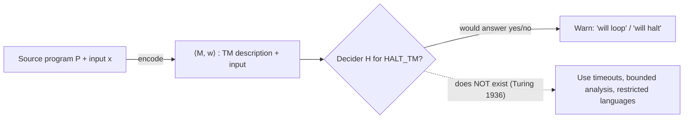

# Task 4 – Formal Language and Automata-Based Real-World Problem Solving
## Problem chosen: (a) Infinite-loop detection in software

**Course:** 21CSC301T Formal Language and Automata | **CO:** CO1–CO5 | **SDG 9 (Level 2 – Design alignment)**
**Team:** _<Team name>_  |  **Members:** _<Name – Reg. No.>_ …  (see §11 for individual contributions)

---
## 1. Real-world problem and assumptions
A build server, an online judge or an app store would like a tool that, given any program P and input x, warns *"P will never terminate on x"* **before** it is run.
**Assumptions.** (i) Programs are deterministic. (ii) "Program" means anything a Turing machine (TM) can compute (C, Python, Java, … are Turing-complete when memory is unbounded). (iii) We want an *exact* answer for *every* program (general case) – then we study restrictions.

**SDG 9 link.** Hanging services and runaway jobs waste compute and cause outages; knowing what can and cannot be guaranteed lets engineers design reliable infrastructure with the right safeguards (timeouts, restricted languages, static analysis).

## 2. Formal model
A TM M = (Q, Σ, Γ, δ, q₀, q_accept, q_reject). A *configuration* is (state, tape contents, head position). A deterministic TM either **halts** (enters q_accept/q_reject) or runs forever. Every real program can be encoded as a string ⟨M⟩, and a **universal TM** U can simulate M on w from the pair ⟨M, w⟩.

## 3. Computational formulation (decision problems)
| Real-world question | Formal language |
|---------------------|-----------------|
| "Does program P terminate on input x?" | **HALT_TM = { ⟨M, w⟩ : M halts on w }** |
| "Will P loop forever on x?" | **LOOP_TM = complement of HALT_TM** |
| "Does P terminate on *every* input?" | TOTAL = { ⟨M⟩ : M halts on all inputs } |



## 4. Is the general problem decidable? – NO
**Theorem.** HALT_TM is undecidable.
**Proof (diagonalisation / contradiction).**
1. Suppose a decider H exists: H(⟨M, w⟩) = *accept* if M halts on w, *reject* otherwise – and H always halts.
2. Build D: *on input ⟨M⟩, run H(⟨M, ⟨M⟩⟩); if H accepts, loop forever; if H rejects, halt.*
3. Run D on its own description ⟨D⟩. If D halts on ⟨D⟩ then H accepted, so D loops – contradiction. If D loops on ⟨D⟩ then H rejected, so D halts – contradiction.
4. Hence H cannot exist. ∎

## 5. Decidable vs. recognisable (semi-decidable)
* **HALT_TM is Turing-recognisable (RE).** The universal TM U simulates M on w; if M halts, U halts and accepts. If M never halts, U never halts – so it does not *decide*.
* **HALT_TM is not co-recognisable.** If both HALT_TM and its complement were recognisable, HALT_TM would be decidable (run both in parallel) – contradicting §4.
* **LOOP_TM (the complement) is not even recognisable.** No algorithm can enumerate "all programs that run forever".

| Problem | Decidable | Recognisable | Co-recognisable |
|---------|:---------:|:------------:|:---------------:|
| HALT_TM ("halts") | ✗ | ✓ | ✗ |
| LOOP_TM ("loops forever") | ✗ | ✗ | ✓ |

**Consequence for tools.** A tool can safely say *"halted after n steps"* but can never, for all programs, say *"never halts"*. A false alarm (flagging a terminating program) or a miss is unavoidable in general.

## 6. Rice's theorem and the sibling problems
Rice's theorem: **every non-trivial semantic property of programs is undecidable** (a property of the *language/function computed*, not of the code text). Therefore:
* **Program-equivalence checking** (L(P₁) = L(P₂)?) is undecidable.
* **Compiler-bug detection** in full generality ("does the compiler preserve the meaning of every program?") is undecidable – compilers are tested on samples and verified for restricted subsets instead.
* Examples of *syntactic* properties that stay decidable: "contains a `while` loop", "has ≤ 100 lines" (they depend on the text, not behaviour).

## 7. Worked example
```
x := 1
while x != 0:  x := x + 2
```
Over **unbounded integers** the configuration (pc, x) never repeats, so a cycle-detector cannot prove looping – but a smarter static argument (x is odd and increases ⇒ never 0) can. For `Collatz(n)` (`while n != 1: n = n/2 if even else 3n+1`), nobody currently knows whether it terminates for all n – a three-line loop already defeats human experts, illustrating the practical meaning of undecidability.

## 8. Feasible restricted-case approaches (engineering workarounds)
| Strategy | Idea | Guarantee |
|----------|------|-----------|
| **Finite-state restriction** (bounded memory) | A deterministic machine with N configurations either halts within N steps or repeats a configuration ⇒ loops forever. Cycle detection decides it. | Exact, but N may be astronomically large (2^bits). |
| **Bounded simulation / watchdog timeout** | Run for at most B steps/seconds; report HALTS, or UNKNOWN. | Sound for "halts"; "unknown" ≠ "loops". |
| **Ranking-function static analysis** | Find a measure that strictly decreases on every loop iteration and is bounded below (e.g. `for (i=n; i>0; i--)`). | Sound but incomplete: proves termination for many loops, fails on others. |
| **Restricted languages** | Only bounded `for` loops / structural recursion (as in total functional languages, SQL without recursion, some PLC languages). | Termination guaranteed by construction; less expressive. |
| **Testing & fuzzing for hangs** | Generate inputs, flag runs exceeding a limit. | Finds bugs, proves nothing. |

**Our implementation – `loopcheck.py`.** A toy register machine and a checker with *three-valued output* HALTS / LOOPS / UNKNOWN. LOOPS is returned only when a full configuration (pc, registers) repeats – a proof, because the machine is deterministic.

| Test | Memory model | Verdict | Steps |
|------|--------------|---------|-------|
| P1 countdown from 5 | unbounded | **HALTS** | 10 |
| P2 `jnz` on constant 1 | unbounded | **LOOPS** | 1 |
| P3 `x+=2`, x₀=1 | unbounded ints | **UNKNOWN** | budget (5000) |
| P3 `x+=2`, x₀=1 | 8-bit wraparound | **LOOPS** | 256 |
| P4 `x+=1`, x₀=1 | 8-bit wraparound | **HALTS** | 510 |

The P3 rows show the key lesson: **the same program is decidable under finite memory and undecidable-in-general under unbounded memory.**

## 9. Practical implications for software/system design
1. Never promise a tool that detects *all* infinite loops; promise *sound* warnings plus *UNKNOWN*.
2. Always combine static analysis with **runtime guards** (timeouts, step quotas, resource limits, circuit breakers).
3. Use **restricted languages/DSLs** for components that must terminate (configuration, rules engines, smart-contract gas limits).
4. For equivalence/bug detection use **testing, translation validation of individual compilations, formal verification of a restricted subset**, never a claim of a universal checker.
5. Report results with three outcomes (proved / refuted / unknown) and document assumptions.

## 10. References (verify edition/page details before submission)
1. A. M. Turing, "On Computable Numbers, with an Application to the Entscheidungsproblem", *Proc. London Math. Soc.*, 1936.
2. M. Sipser, *Introduction to the Theory of Computation*, Cengage (chapters on decidability and the halting problem).
3. J. E. Hopcroft, R. Motwani, J. D. Ullman, *Introduction to Automata Theory, Languages, and Computation*, Pearson.
4. H. G. Rice, "Classes of Recursively Enumerable Sets and Their Decision Problems", *Trans. AMS*, 1953.
5. B. Cook, A. Podelski, A. Rybalchenko, "Proving Program Termination", *Communications of the ACM*, 2011.

## 11. Individual contribution statement (fill in – one row per member)
| Member | Role (modelling / analysis / validation / documentation) | Contribution |
|--------|-----------------------------------------------------------|--------------|
| _<Name>_ | | |
| _<Name>_ | | |
| _<Name>_ | | |

## 12. Reproduce
```bash
python3 loopcheck.py
python3 test_loopcheck.py
```
